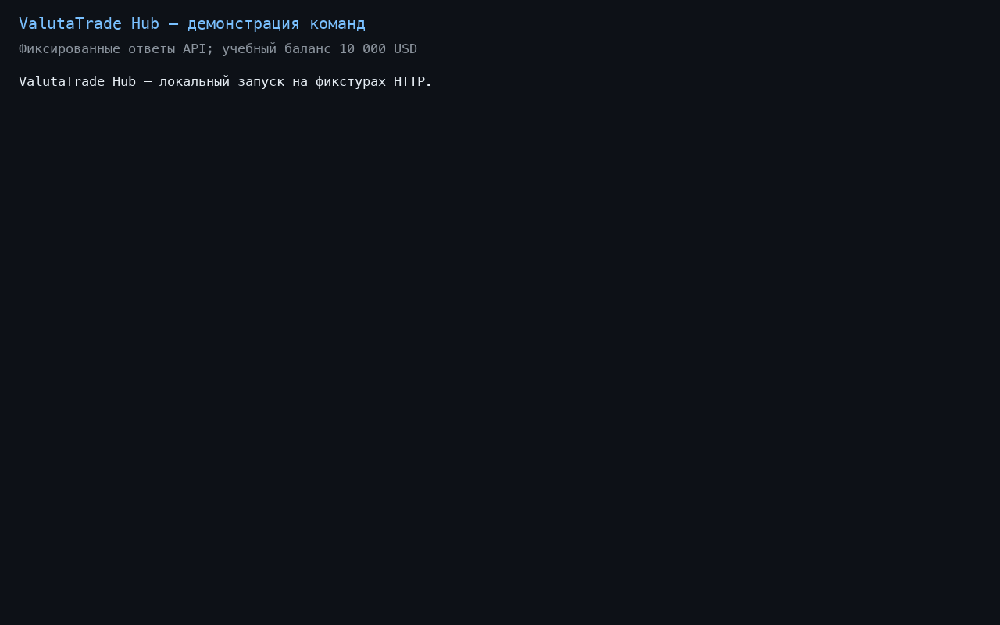

# Python, итоговый проект — ValutaTrade Hub

Сергеев Максим Александрович, группа М26-555.

Виртуальный валютный кошелёк: регистрация, покупка и продажа валют, оценка портфеля.

Структура: `data/` — JSON-хранилища; `valutatrade_hub/core/` — модели и операции,
`infra/` — настройки, хранение и курсы; `parser_service/` — API и обновление,
`cli/` — команды. `logging_config.py` и `decorators.py` — журналирование.

Нужны Python 3.12 и [uv](https://docs.astral.sh/uv/).

```bash
make install
make run
```

Команды вводятся в одной сессии; `help` — справка, `exit` — выход.

```text
register --username alice --password 1234
login --username alice --password 1234
update-rates
buy --currency BTC --amount 0.05
sell --currency BTC --amount 0.01
show-portfolio --base USD
get-rate --from USD --to BTC
show-rates --top 2
```

Новый портфель пуст. Для учебных сделок при закрытом приложении задайте USD-баланс
в объекте своего пользователя внутри списка `data/portfolios.json` (пример для id=1):
`{"user_id": 1, "wallets": {"USD": {"currency_code": "USD", "balance": 10000}}}`.

Курсы берутся из CoinGecko и ExchangeRate-API. Ключ второго сервиса задаётся
переменной окружения `EXCHANGERATE_API_KEY` перед запуском.
`update-rates [--source coingecko|exchangerate]` обновляет данные вручную;
`uv run python -m valutatrade_hub.parser_service.scheduler` — периодически.

Кэш — `data/rates.json`, история — `data/exchange_rates.json`. TTL — 300 секунд,
настраивается в `[tool.valutatrade]` файла `pyproject.toml`. При устаревании
выполняется обновление; без свежего курса сделка отклоняется. Ошибки выводятся
сообщениями, логи сохраняются в `logs/`.



[Запись](demo/session.cast). Для воспроизводимости демо использует фиксированные
ответы API из `demo/fixtures` и отдельный учебный баланс 10 000 USD.
